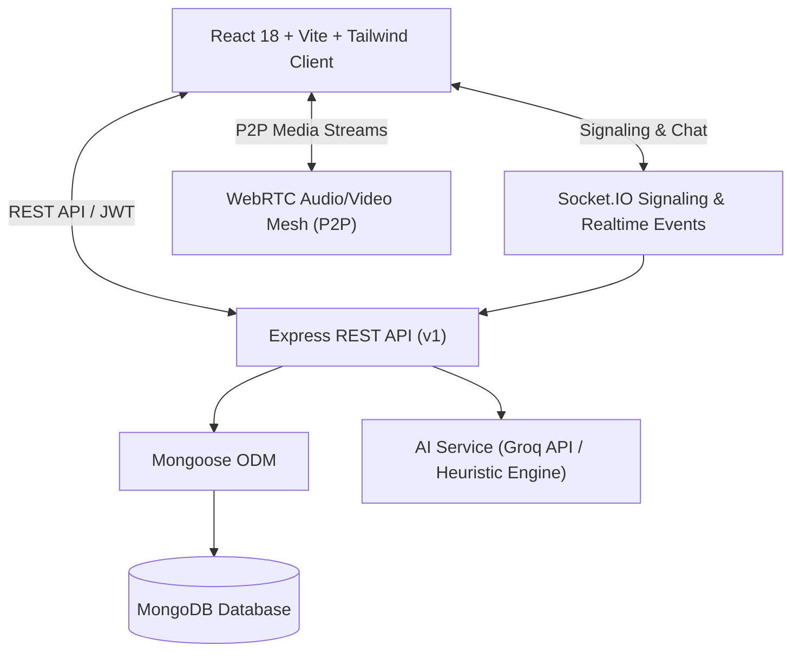

# HireSprint Architecture

## Overview
HIRESPRINT is an AI-Powered Group Discussion (GD) and Learning Management Portal built with the MERN stack (MongoDB, Express, React, Node.js + TypeScript).
It enables students to prepare for high-stakes placement group discussions via two core modes:
1. **AI Practice Mode**: A single student practices with an autonomous AI Moderator and diverse AI Personas (analytical, contrarian, data-driven, etc.) with controlled turn-taking and speech-to-text / text interactions.
2. **Live GD Mode**: Real student-to-student audio/video group discussions via WebRTC mesh with Socket.IO signaling, real-time shared transcripts, and an active AI Moderator providing non-intrusive guidance, warnings, follow-up questions, and end-of-session evaluations.

The platform provides a comprehensive Learning Management System (LMS) with 5 distinct role-based dashboards:
- **STUDENT**: View assignments, join upcoming live GDs, launch AI practice, view skill progress, evaluations, and attendance.
- **ADMIN**: User & role management, platform settings, audit logs, system health monitoring.
- **TEACHER**: Topic creation, live session scheduling, learning resources, assignments, review transcripts, evaluations, and manual grading feedback.
- **TNP (Training & Placement Cell)**: Placement readiness reports, aggregated cohort skill trends, GD participation metrics, CSV exports.
- **STUDENT_COORDINATOR**: Manage assigned sessions, waiting room, start/stop meetings, monitor attendance and participant rosters.

## System Components

## Security & State Machine
- Server-authoritative GD session lifecycle: `CREATED` -> `READY` -> `ACTIVE` -> `PAUSED` -> `EVALUATING` -> `COMPLETED` / `CANCELLED`.
- JWT-based authentication with role-based access control (RBAC).
- Zero aptitude functionality in accordance with strict placement GD focus.
