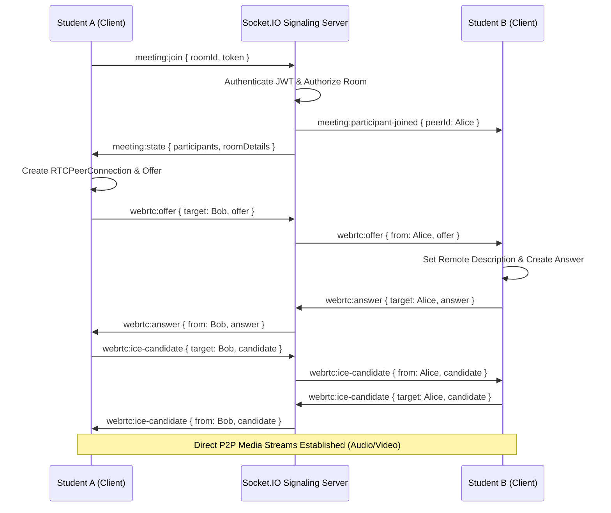

# HireSprint WebRTC & Socket.IO Architecture

## Overview
HireSprint uses a peer-to-peer (P2P) WebRTC mesh topology coordinated by an authenticated Socket.IO signaling layer for real-time video, audio, and meeting state synchronization.

## Signaling Protocol

All signaling events are strictly authenticated via JWT and validated server-side to ensure that clients only communicate within authorized rooms.

## Mesh Architecture vs. SFU
- **Current Mesh Topology**: For university GDs (typically 4–8 students), WebRTC mesh provides ultra-low latency without requiring complex media server hosting.
- **Future SFU Compatibility**: The signaling abstraction separates media control from meeting state, allowing seamless drop-in replacement with an SFU (e.g., LiveKit / Mediasoup) when larger cohorts (>10 students per room) are required.

## Live Meeting Features
- Waiting room with audio/video device preview
- Microphone mute / unmute
- Camera enable / disable
- Raise hand indicator
- Real-time in-meeting chat
- Real-time speech transcription stream
- Real-time AI Moderator interventions
- Participant leave and disconnection cleanup
- Automatic attendance logging
